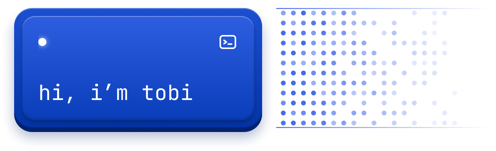
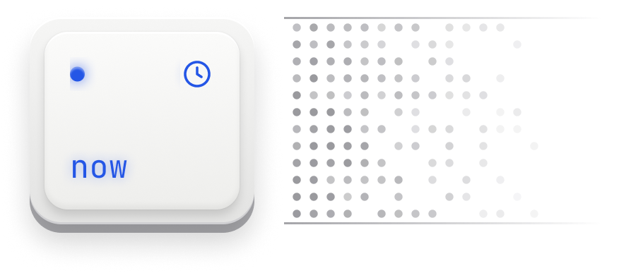
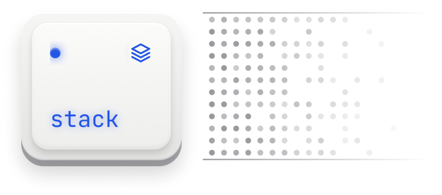
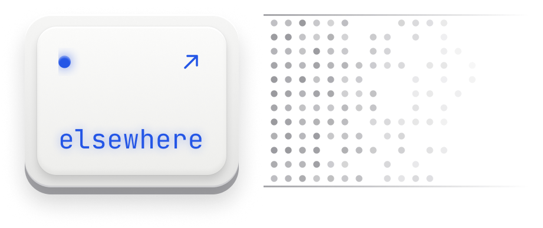

 
I build AI systems and the products around them. I teach a lot, 
so I'm used to making complicated things simple, and I build the same way.

 

 
Software Laboratory Assistant @ BINUS. Going deeper into deep learning, product engineering and cyber security. 
Swift and iOS are next, at the Apple Developer Academy in 2027.

 

 
**Models** · Python, NLP, computer vision, classical & ensemble learning 
**Build** · React, Node.js, NestJS, Prisma, Kotlin 
**Data** · SQL Server, MySQL, Power BI, ETL & OLAP 
**Ship** · Docker, Kubernetes, Terraform, Azure 
**Test** · Selenium, K6, Prometheus, Grafana

 

 
**[LinkedIn](https://linkedin.com/in/rafaeltobiasgosal)** · **[Email](mailto:rafael.gosal@binus.ac.id)** · Feel free to say hi!
