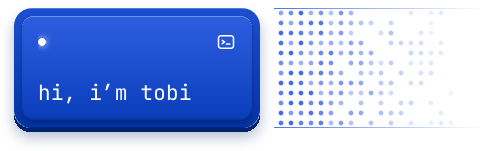
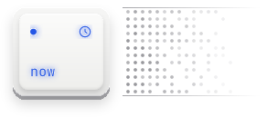
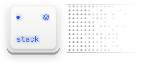
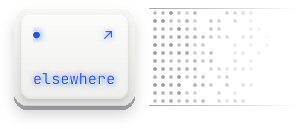

 
Half of me is tuning hyperparameters at 2am. The other half is asking "okay, but who's going to use this?" Together we're a software engineer who builds AI products: smart on the inside, simple on the outside.

 

 
Going deeper into deep learning, product engineering and cyber security. Swift and iOS are next, at the Apple Developer Academy in 2027.

 

 
**Models** · Python, NLP, computer vision, classical & ensemble learning 
**Build** · React, Node.js, NestJS, Prisma, Kotlin 
**Data** · SQL Server, MySQL, Power BI, ETL & OLAP 
**Ship** · Docker, Kubernetes, Terraform, Azure 
**Test** · Selenium, K6, Prometheus, Grafana

 

 
**[LinkedIn](https://linkedin.com/in/rafaeltobiasgosal)** · **[Email](mailto:tobiasgosal@gmail.com)** · Feel free to say hi!
